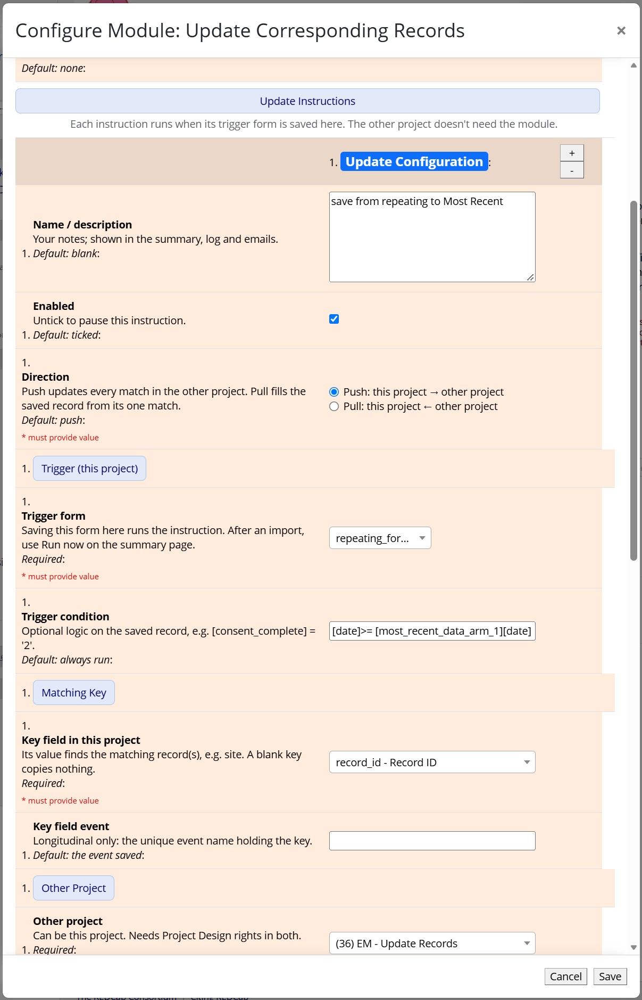
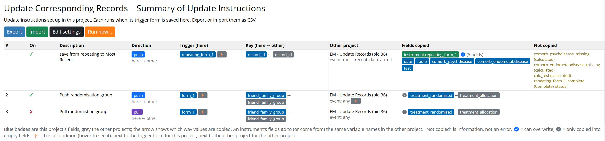

# Update Corresponding Records

Keeps matching records up to date. When a form or survey is saved, this module copies field values to, or from, the records that share a key value, in another project or the same one.

- **Push** (this project → other): copies values to **every** matching record. Use it to send changes out, e.g. a site's new contact details to all of its participants.
- **Pull** (this project ← other): copies values from the **one** matching record into the record just saved. Use it to look something up, e.g. a new participant's site details.

At the time this module was developed, [Copy Data on Save](https://github.com/lsgs/redcap-copy-data-on-save) copied to at most one record per instruction. This module updates all matching records and can pull as well as push. It never creates records, and can't save into REDCap-derived variables.

## Prerequisites
- REDCap >= 14.6.4 (LTS >= 15.0.9), the first versions supporting Module Framework version 16
- REDCap Module Framework version 16

## Easy Installation
- Install the Update Corresponding Records module from the Consortium [REDCap Repo](https://redcap.vanderbilt.edu/consortium/modules/index.php) from the control center.
- Go to **Control Center > External Modules**, enable Update Corresponding Records.

## Manual Installation
- Clone this repo into `<redcap-root>/modules/update_corresponding_records_v1.0.0`.
- Go to **Control Center > External Modules**, enable Update Corresponding Records.

## Setting up an instruction

You need **Project Design rights** in this project and in the other project. Instructions whose other project you don't have Design rights in are shown **read only** in the Configure dialog, with a note; they still run, and only someone with rights in both projects (or an administrator) can change or delete them.

1. Enable the module in the project whose form, when saved, should start the copy. (**External Modules > Manage**). The other project doesn't need the module.
2. Click **Configure** next to Update Corresponding Records. Each **Update Configuration** is one instruction; use **+** to add more.
3. Choose the **Direction**, the **Trigger form**, and the **key fields** that link the records in the two projects.
4. Choose the **Other project** (it can be this project).
5. Choose what to copy: **Copy an entire instrument** (fields with the same variable names), or individual fields under **Also copy**, or both. If copying an entire instrument, individual fields can be excluded.
6. Click **Save**. Then open **View summary of update instructions** (under the module's name, or **Open** in the Configure dialog) and fix anything listed under **Issues**.
7. Test it: save the trigger form on a test record and check the other record.

### Example

A **Sites** project (key = site_code, with `site_pi` and `site_pi_email`) and a **Participants** project (a `site` dropdown with the same codes):

| Set up in | Direction | Key here ↔ key there | Runs when | Does |
|---|---|---|---|---|
| Participants | Pull | `site` ↔ `site_code` | the enrolment form is saved | copies the site's PI details into the participant |
| Sites | Push | `site_code` ↔ `site` | the site form is saved | sends PI changes to every participant at that site |

Example uses:

- **Screening to enrolment** (one-to-one): the study project pulls `age` and `sex` (1, Female | 2, Male | 3, Intersex | 4, Prefer not to say) by screening ID.
- **Household members** (same project): a household record pushes its address to every member record that stores its record ID. Also could work for cluster randomising a family to an intervention group (push only; randomisation of first or primary family member pushes to linked records)
- **Latest visit** (same project): a push from the repeating visit form (record ID ↔ record ID, **Other project event** "Latest Visit", copy the visit instrument) keeps a copy of the visit saved last. Can be used with a trigger condition based on latest date.
- **Sample status** (into repeating instances): a sample tracking project pushes `sample_status` to the participant's "Samples" instance with the same `sample_id`.
- **Data access requests** (pull initially, then keep up to date): new requests pull the dataset's custodian; the dataset register pushes changes to open requests only, with `[request_closed] <> '1'`.

## Configuration

| Setting | Default | Values and limitations |
|---|---|---|
| **Log copied values** | Off | Adds the copied values to the module log, for troubleshooting. Values may identify people, so turn it off afterwards. |
| **Failure alert email** | None | Emailed when an instruction fails. Emails never include values. |
| **Name / description** | Blank | Your notes; shown on the summary page, in the log and in emails. |
| **Enabled** | Ticked | Untick to pause the instruction. |
| **Direction** | Push | **Push**: to every matching record. **Pull**: from one matching record; more than one match fails (nothing copied, logged and emailed). |
| **Trigger form** | Required | Saving this form (data entry or survey) runs the instruction. On a repeating form, the instance just saved is used. |
| **Trigger condition** | Always run | REDCap logic on the record just saved, e.g. `[consent_complete] = '2'`. To copy only a later date: `[date] >= [latest_arm_1][date]`. |
| **Key field in this project** | Required | The value that links the records. May be calculated. Not a multiple-answer checkbox, file or descriptive field. A blank key means nothing is copied. |
| **Key field event** | Event saved | Longitudinal projects: the event holding the key. |
| **Other project** | Required | Any project you have Design rights in, including this one. |
| **Key field in other project** | Required | Push: may repeat across records. Pull: should be unique, ideally the record ID. Values must match exactly (case, spaces and leading zeros count). |
| **Other project event** | Any event | Longitudinal projects: the event to copy to (push) or from (pull). |
| **Condition in other project** | Every match | REDCap logic checked on each matching record, using that project's fields, e.g. `[withdrawn] <> '1'`. Matches where it's false are left alone (push) or ignored (pull). It can't see the record just saved. |
| **Copy an entire instrument** | None | Copies every field on the instrument to (or from) the field with the same name in the other project. Fields that can't be copied are skipped and listed on the summary page under **Not copied**. |
| **Copy only if destination field empty (don't update)?** (instrument) | Unticked | Ticked: the instrument's fields are only copied into empty fields. Shown once an instrument is chosen. |
| **Leave out** | None | Fields on that instrument not to copy. Shown once an instrument is chosen. |
| **Also copy** | None | Individual fields: extra fields from other instruments, a field whose name differs in the other project, or (with no instrument) every field to copy. Leave **Field name in other project** blank for the same name. |
| **Copy only if destination field empty (don't update)?** (Also copy) | Unticked | Ticked: this field is only copied into an empty field. |

## How copying works

- **Values are overwritten**, including with blanks, so the receiving record matches. Only values that differ are written.
- **Only if empty** fields are left alone once they have a value. `0` and "No" count as values; a checkbox is empty when no box is ticked. Later changes won't reach a field that already has a value, so the two projects can differ.
- **Multiple-answer checkboxes** are copied as a whole set, into a checkbox with the same choice codes and labels. It may have extra choices, which are unticked.
- **Dropdowns and radio buttons** are copied as codes, so use the same codes in both projects.
- **Locked forms and records** are left alone, as in REDCap. Everything else is still copied.
- **Surveys:** instructions run when a survey is submitted, with nobody logged in. Pulled fields can be on the survey (e.g. hidden with `@HIDDEN-SURVEY`).
- **Repeating forms:** a repeating trigger form copies from (or pulls into) the instance just saved. A push updates every repeating instance in the other project whose key matches, when the key field is on that repeating form.
- **Within the same record** (e.g. radio `var1` to radio `var2` on the same form): set **Other project** to this project and both key fields to the record ID, then push `var1` to `var2` under **Also copy**. `var2` is set straight after the form is saved, including on surveys. With **Other project event** blank, every event of the record that has `var2`'s form gets the value; set it to limit this to one event.
- **Within the same project**, the record just saved counts as a match like any other. A pull keyed on a value other records share (e.g. the same `household_id`) therefore matches itself too, and fails as more than one match; pull by the other record's record ID instead.
- Make copied fields `@READONLY` in the receiving project, because edits there are overwritten by the next copy.
- **Fields not used in an event** are skipped there. When every event of a record matches, each event only gets the fields its forms hold.

## Using the summary page

**View summary of update instructions** lists this project's instructions, what each copies, and any **Issues** that stop it running. An instruction with Issues is skipped until they're fixed.

- **Export**: download the instructions as a CSV file.
- **Import**: replace this project's instructions with a CSV file (Project Design rights needed). Imported instructions come in switched off, with **Other project** blank, because a project ID copied from another server may be a different project here. Choose each other project in **Edit settings**, then tick **Enabled**. Import isn't available while the project has read-only instructions (see above), because it would delete them.
- **Edit settings**: open the Configure dialog.
- **Run now…**: run instructions for every record, as if each trigger form had just been saved. Use it after a data import or API update, which don't run instructions. Keep the page open until it finishes; running it again is safe.

## Checking what happened

- **Logging** in the receiving project shows each change, with the Username "Update Corresponding Records (#1 from PID 12 record 3)": the instruction number in the project it's set up in, and where the values came from.
- **Logging** in the project the push is set up in shows one row per push, e.g. "Updated responses in PID 34", with the fields and records updated.
- A **failure** (e.g. a pull with more than one match) adds a row such as "Pull failed from PID 12", and emails the **Failure alert email** addresses.
- **External Modules > View Logs** has an entry for each run, with details under **Show Parameters**, including any skipped matches and fields left alone because they're locked.

## What isn't supported

- **Creating records**: only existing matching records are updated.
- **Imports, the API and Data Quality** don't run instructions; use **Run now…** afterwards.
- **File upload, signature and descriptive fields** aren't copied. Calculated, `@CALCTEXT`, `@CALCDATE` and SQL fields can't be copied into, and are skipped in whole-instrument copies.
- **A pull with more than one match** fails; nothing is copied.
- **Pulling from repeating forms**: set **Other project event** to an event where the form doesn't repeat.
- **Pushing to a repeating form matched on the record ID**: there's no way to tell which instance to update, so those fields aren't copied. Put the key on the repeating form instead.
- **Chains**: values copied by this module don't start other instructions.
- **Checking rights when an instruction runs**: Design rights are checked when instructions are saved, imported or run with **Run now**, not on each save.
- **Very large projects** may notice slightly slower saves, as the module searches the other project for matching keys.

## AI assistance
Development of this project has made extensive use of AI assistance. AI tools, primarily Claude Pro, have been used throughout the development process, including for discussion and refinement of design and architecture, implementation and refactoring of code, debugging and review, and preparation and revision of documentation.

The extent and nature of this assistance vary across the project and are not attributed to individual commits. AI-generated suggestions and contributions are reviewed, adapted, and integrated as part of the normal development process.

Responsibility for the design, implementation, maintenance, and released software remains entirely with the project maintainer.

## Acknowledgments

Developed by Kerrin Palazzi, Hunter Medical Research Institute. Strongly influenced and based on [Copy Data on Save](https://github.com/lsgs/redcap-copy-data-on-save) by Luke Stevens, Murdoch Children's Research Institute.
